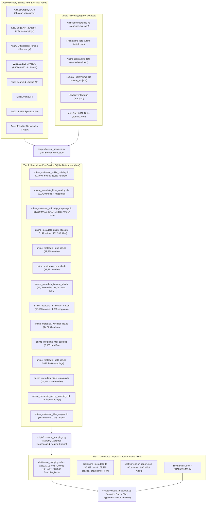
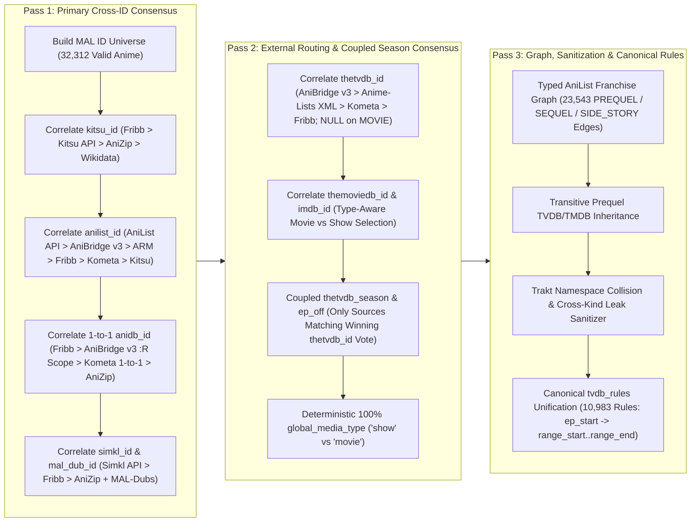
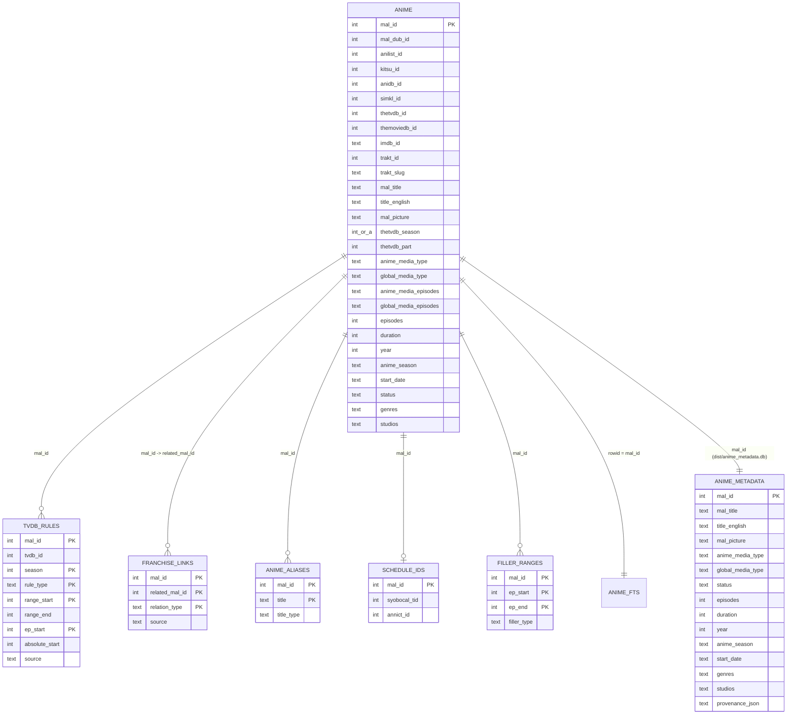
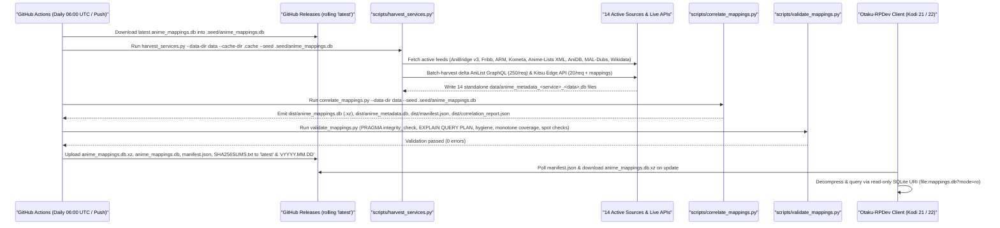

# Otaku Mapping DB (`RPDevs-Builds/Otaku-Mapping-DB`)

Automated, multi-source correlated, cryptographically verified anime cross-platform ID mapping and metadata database suite for **[Otaku-RPDev](https://github.com/RPDevs-Builds/Otaku-RPDev)**.

---

## 1. Architectural Overview & Design Principles

`Otaku-Mapping-DB` is built around a **three-tier data architecture** designed for maximum data integrity, source provenance, and runtime query performance on low-RAM streaming devices (such as Android TV / Kodi):

1. **Strictly Active, Vetted Data Sources Only**:
   - Every upstream data source is vetted for active maintenance. Archived or dead upstream repositories are excluded from the pipeline so stale mappings and frozen metadata never pollute the database.
2. **Tier 1 — Standalone Per-Service Databases (`data/anime_metadata_<service>_<data>.db`)**:
   - Before any merging occurs, [scripts/harvest_services.py](scripts/harvest_services.py) harvests **100% of each active service or aggregator** into its own standalone SQLite database in `data/` (`15` databases total), preserving raw service schemas, external IDs, localized titles, episode range descriptors, and harvest timestamps.
3. **Tier 2 — Authority-Weighted Cross-Service Correlation Engine (`scripts/correlate_mappings.py`)**:
   - [scripts/correlate_mappings.py](scripts/correlate_mappings.py) joins all 15 per-service databases across `mal_id`, `anilist_id`, `anidb_id`, and `kitsu_id`, resolves cross-source ID and metadata claims via authority-weighted consensus voting, couples season/offset claims strictly to the winning `thetvdb_id`, unifies split-cour and multi-season episode rules into canonical coordinates, and emits a machine-auditable [dist/correlation_report.json](dist/correlation_report.json).
4. **Tier 3 — Separated Interconnect vs. Metadata Outputs (`dist/`)**:
   - **`dist/anime_mappings.db` (+ `.xz`)**: The lean service-interconnect and seasonal/episode routing database consumed directly by `Otaku-RPDev` for cross-platform ID lookups (`MAL` ↔ `AniList` ↔ `Kitsu` ↔ `AniDB` ↔ `Simkl` ↔ `TVDB` ↔ `TMDB` ↔ `IMDb` ↔ `Trakt` ↔ `MAL-Dubs` ↔ `Syobocal`/`Annict`/`LiveChart`/`AniSearch`/`Anime-Planet`/`ANN`/`AnimeCountdown`), `tvdb_rules` episode translation, and typed `franchise_links` (`PREQUEL`/`SEQUEL`) traversal.
   - **`dist/anime_metadata.db` (+ `.xz`)**: The comprehensive correlated metadata database (`32,315` shows, `102,754` normalized title aliases, `20,003` synopses, `26,004` native titles, `19,186` age ratings, `external_ids`, `metadata_fts` FTS5 search, per-field source provenance JSON, genres, studios, release dates, and filler ranges) built from the 15 per-service databases.

---

## 2. End-to-End Architecture & Data Flow Diagrams

### 2.1 Multi-Tier Harvesting, Correlation & Distribution Pipeline



---

### 2.2 Cross-Service Correlation & Conflict-Resolution Pipeline



---

### 2.3 Entity-Relationship Diagram (`dist/anime_mappings.db` & `dist/anime_metadata.db`)



---

### 2.4 Automated CI/CD & `Otaku-RPDev` Distribution Sequence



---

## 3. Source Vetting: Active vs. Retired Upstream Sources

### 3.1 Retired / Excluded Stale Sources

| Retired Source | Upstream Status | Reason for Exclusion & Active Replacement |
|---|---|---|
| `manami-project/anime-offline-database` | **ARCHIVED** (`2026-07-04`, read-only at release `2026-27`) | Frozen repository; replaced by direct **AniList GraphQL** (`anime_metadata_anilist_catalog.db`), **Kitsu Edge API** (`anime_metadata_kitsu_catalog.db`), **AniDB Daily Titles**, and active ID aggregators. |
| `eliasbenb/PlexAniBridge-Mappings` | **ARCHIVED** (`2026-04-05`, read-only) | Superseded by its official active v3 successor **[`anibridge/anibridge-mappings`](https://github.com/anibridge/anibridge-mappings/releases/tag/v3)** (`anime_metadata_anibridge_mappings.db`). |
| `MALSync/MAL-Sync-Backup` (GitHub raw) | **DEAD (`HTTP 451` takedown on GitHub)** | Dead raw GitHub URL removed; replaced by **`anibridge/anibridge-mappings` v3**, **`Anime-Lists/anime-lists` XML**, and live **`api.ani.zip` / `api.malsync.moe`**. |

### 3.2 Active Vetted Sources & Per-Service Databases (`data/`)

| # | Per-Service Database (`data/`) | Active Upstream Source | Cadence | Primary Tables & Row Counts |
|---:|---|---|---|---|
| 1 | `anime_metadata_anilist_catalog.db` | **AniList GraphQL API** (`https://graphql.anilist.co`) | Live API | `anilist_media` (**`22,694`** rows), `anilist_relations` (**`23,811`** typed relation edges) |
| 2 | `anime_metadata_kitsu_catalog.db` | **Kitsu Edge API** (`https://kitsu.app/api/edge/anime?include=mappings`) | Live API | `kitsu_media` (**`22,420`** rows with `start_date`, `end_date`, `title_en`, synonyms, and external mappings) |
| 3 | `anime_metadata_anibridge_mappings.db` | **[`anibridge/anibridge-mappings` v3](https://github.com/anibridge/anibridge-mappings/releases/tag/v3)** (`mappings.min.json`) | Active Daily/Weekly | `anibridge_mal_summary` (**`21,610`** rows), `anibridge_edges` (**`264,041`** descriptor range edges), `anibridge_tvdb_rules` (**`9,357`** episode rules) |
| 4 | `anime_metadata_anidb_titles.db` | **AniDB Daily Official Titles** (`anime-titles.xml.gz`) | Active Daily | `anidb_anime` (**`17,141`** rows), `anidb_titles` (**`102,338`** localized/synonym title rows) |
| 5 | `anime_metadata_fribb_ids.db` | **[`Fribb/anime-lists`](https://github.com/Fribb/anime-lists)** (`anime-list-full.json`) | Active Weekly | `fribb_entries` (**`39,779`** rows across 13 provider IDs) |
| 6 | `anime_metadata_arm_ids.db` | **[`kawaiioverflow/arm`](https://github.com/kawaiioverflow/arm)** (`arm.json`) | Active Weekly | `arm_entries` (**`37,281`** rows linking `mal_id`, `anilist_id`, `annict_id`, `syobocal_tid`) |
| 7 | `anime_metadata_kometa_ids.db` | **[`Kometa-Team/Anime-IDs`](https://github.com/Kometa-Team/Anime-IDs)** (`anime_ids.json`) | Active Daily | `kometa_entries` (**`17,050`** rows), `kometa_mal_links` (**`14,087`** MAL links with `is_1to1` flag) |
| 8 | `anime_metadata_animelists_xml.db` | **[`Anime-Lists/anime-lists`](https://github.com/Anime-Lists/anime-lists)** (`anime-list-full.xml`) | Active Daily | `animelists_entries` (**`10,793`** rows), `animelists_mappings` (**`1,893`** `<mapping>` elements) |
| 9 | `anime_metadata_wikidata_ids.db` | **Wikidata Live SPARQL** (`https://query.wikidata.org/sparql`) | Live SPARQL | `wikidata_entries` (**`14,609`** cross-ID bindings across P4086, P8729, P5646, P8731, P4835, P4983, P4947, P345) |
| 10 | `anime_metadata_mal_dubs.db` | **[`MAL-Dubs/MAL-Dubs`](https://github.com/MAL-Dubs/MAL-Dubs)** (`dubInfo.json`) | Active Daily | `mal_dubs` (**`5,955`** complete/incomplete English dub MAL IDs) |
| 11 | `anime_metadata_simkl_catalog.db` | **Simkl API** (`https://api.simkl.com`) | Live API & Verified Seed | `simkl_entries` (**`14,175`** rows) |
| 12 | `anime_metadata_trakt_ids.db` | **Trakt API** (`https://api.trakt.tv`) | Live API & Verified Seed | `trakt_mappings` (**`12,841`** media-kind-scoped Trakt IDs) |
| 13 | `anime_metadata_filler_ranges.db` | **AnimeFillerList** (`https://www.animefillerlist.com/shows`) | Live Index & Cache | `filler_shows` (**`164`** shows), `filler_ranges` (**`1,278`** mapped filler/recap intervals) |
| 14 | `anime_metadata_anizip_mappings.db` | **AniZip API** (`https://api.ani.zip/mappings`) | Live API | `anizip_entries` (delta live API mappings) |

---

## 4. Correlated Coverage & Data-Integrity Invariants (`v2.7`)

### 4.1 Column & Relational Coverage (`32,312` Total Correlated Anime)

| Column / Table | Populated Count | Catalog Share | Primary Correlated Sources |
|---|---:|---:|---|
| `mal_id` | **`32,312`** | `100.0%` | Primary Key (`INTEGER`) |
| `mal_title` | **`32,312`** | `100.0%` | AniList Romaji, Kitsu Romaji/Canonical, AniDB Main, Anime-Lists XML, Verified Seed |
| `anime_media_type` | **`32,312`** | `100.0%` | AniList (`TV`, `MOVIE`, `OVA`, `ONA`, `SPECIAL`, `MUSIC`), Kitsu, Fribb, Simkl |
| `global_media_type` | **`32,312`** | `100.0%` | Deterministic `'show'` vs `'movie'` routing classification |
| `status` | **`32,303`** | `99.97%` | AniList GraphQL, Kitsu Edge API |
| `mal_picture` | **`32,268`** | `99.86%` | MAL CDN suffix / AniList coverImage / Kitsu posterImage |
| `episodes` / `anime_media_episodes` | **`31,823`** | `98.49%` | AniList GraphQL, Kitsu Edge API, AniZip, Simkl |
| `duration` (seconds) | **`31,368`** | `97.08%` | AniList GraphQL, Kitsu Edge API |
| `year` | **`31,251`** | `96.72%` | AniList `seasonYear`/`startDate`, Kitsu `startDate`, Simkl |
| `genres` | **`29,911`** | `92.57%` | AniList GraphQL, Simkl |
| `anime_season` (`WINTER`..`FALL`) | **`28,983`** | `89.70%` | AniList GraphQL, Kitsu `startDate` month derivation |
| `start_date` (`YYYY-MM-DD`) | **`25,245`** | `78.13%` | AniList GraphQL `startDate`, Kitsu Edge API `startDate` |
| `anilist_id` | **`22,873`** | `70.79%` | AniList GraphQL, AniBridge v3, ARM, Fribb, Kometa, Kitsu `include=mappings`, Wikidata |
| `kitsu_id` | **`20,920`** | `64.74%` | Fribb, Kitsu Edge API, AniZip, Wikidata |
| `studios` | **`20,479`** | `63.38%` | AniList GraphQL main animation studios, Simkl |
| `title_english` | **`16,495`** | `51.05%` | AniList `title.english`, AniDB `official`/`en`, Kitsu `titles.en`, Simkl |
| `anidb_id` (1-to-1 Verified) | **`15,971`** | `49.43%` | Fribb, AniBridge v3 (`:R` regular scope), Kometa 1-to-1, AniZip, Kitsu, Wikidata |
| `simkl_id` | **`14,172`** | `43.86%` | Simkl API, Fribb, AniZip |
| `themoviedb_id` | **`12,869`** | `39.83%` | AniBridge v3 (`tmdb_movie`/`tmdb_show`), Anime-Lists XML, Fribb, Wikidata |
| `trakt_id` | **`12,761`** | `39.49%` | Trakt API, Kitsu `include=mappings`, Verified Seed (sanitized for cross-kind/same-kind collisions) |
| `thetvdb_season` / `thetvdb_part` | **`11,601`** | `35.90%` | Coupled consensus across AniBridge v3, Anime-Lists XML, Kometa, Fribb, Kitsu |
| `imdb_id` (`tt\d+`) | **`11,364`** | `35.17%` | AniBridge v3, Anime-Lists XML, Kometa, Fribb, Wikidata |
| `thetvdb_id` (Series Only) | **`9,818`** | `30.39%` | AniBridge v3, Anime-Lists XML, Kometa, Fribb, Kitsu, Wikidata (`NULL` on `MOVIE` entries) |
| `mal_dub_id` | **`5,951`** | `18.42%` | `MAL-Dubs/MAL-Dubs` |
| `tvdb_rules` (Table) | **`10,983` rules** | — | Canonical episode-range translation rules from AniBridge v3 & Anime-Lists XML |
| `franchise_links` (Table) | **`23,543` edges** | — | 100% typed AniList `PREQUEL`, `SEQUEL`, `SIDE_STORY`, `PARENT`, `SPIN_OFF`, `ALTERNATIVE`, `SUMMARY` edges |
| `schedule_ids` (Table) | **`13,083` rows** | — | `syobocal_tid` & `annict_id` broadcast schedule IDs from ARM & Wikidata |
| `anime_aliases` (Table) | **`58,567` / `102,119`** | — | `58,567` top-5 slim aliases in `anime_mappings.db`; `102,119` full aliases in `anime_metadata.db` |
| `filler_ranges` (Table) | **`1,278` ranges** | `143` shows | Non-canon episode intervals (`Filler`, `Mixed Canon/Filler`, `Recap`) from AnimeFillerList |

---

### 4.2 Data-Integrity Guardrails Enforced by `correlate_mappings.py` & `validate_mappings.py`

1. **Canonical `tvdb_rules` Coordinate System**:
   - Every rule in `tvdb_rules` uses a single bidirectional coordinate contract across `AniBridge v3` and `Anime-Lists XML`:
     - `ep_start`: 1-based **local MAL episode start** (`ep_s`).
     - `range_start` .. `range_end`: 1-based **target TVDB season episode range** (`rs .. re`).
     - **Forward (MAL Episode `E` → TVDB Season `S`, Episode `T`)**: When `ep_s <= E <= ep_s + (re - rs)`, `T = rs + (E - ep_s)`. Works identically for 1-to-1 seasons (`rs == ep_s`), split-cour Part 2 seasons (`rs > ep_s`, e.g. Cour 2 `ep 1..12` → TVDB `S1E13..24`), and multi-season long-running single MAL IDs (`ep_s > rs`, e.g. *One Piece* `mal_id=21` `ep 9..30` → TVDB `S2E1..22`).
     - **Reverse (TVDB Season `S`, Episode `T` → MAL Episode `E`)**: When `rs <= T <= re`, `E = ep_s + (T - rs)`.
2. **Strict `thetvdb_id` ↔ `thetvdb_season` / `ep_off` Coupling**:
   - A source is only permitted to vote on `thetvdb_season` or contribute an `episode_offset` if its claimed `thetvdb_id` matches the consensus-winning `anime.thetvdb_id`, preventing cross-ID season mismatches when an OVA has both a standalone TVDB entry and a parent-series Season 0 entry.
3. **1-to-1 Regular-Scope AniDB Guard**:
   - In AniDB, multiple MAL TV Specials are often folded into a parent TV series's `anidb_id` under Special scope (`:S`). `correlate_mappings.py` only assigns `anidb_id` from 1-to-1 mappings and Regular (`:R`) scope, preventing child specials from inheriting their parent show's `anidb_id` or Season 1 mapping.
4. **Zero Seed-Echo Triple-Voting**:
   - `anime_metadata_trakt_ids.db` and `anime_metadata_simkl_catalog.db` only vote on `thetvdb_id`, `themoviedb_id`, or `imdb_id` when the record originated from a direct `trakt_api` or `simkl_api` response (`source != 'seed'`), ensuring legacy seed values never outvote active upstream sources.
5. **Query-Plan & Index Verification (`EXPLAIN QUERY PLAN`)**:
   - `validate_mappings.py` executes `EXPLAIN QUERY PLAN` across every hot lookup column (`mal_id`, `anilist_id`, `kitsu_id`, `anidb_id`, `simkl_id`, `thetvdb_id`, `themoviedb_id`, `imdb_id`, `trakt_id`, `mal_dub_id`, `mal_title LIKE 'Prefix%'`, composite seasonal browse, TVDB sibling ordering, `anime_fts` FTS5 `MATCH`, `anime_aliases`, `franchise_links`, and `filler_ranges`) and fails the build if any query degrades to a full table `SCAN` or `TEMP B-TREE` sort.

---

## 5. Release Assets (`releases/latest`)

Each automated run publishes verified artifacts to the rolling [`latest`](https://github.com/RPDevs-Builds/Otaku-Mapping-DB/releases/tag/latest) and dated `vYYYY.MM.DD` GitHub Releases:

- **`anime_mappings.db.xz`** (~5.3 MB LZMA-compressed SQLite database consumed by `Otaku-RPDev`)
- **`anime_mappings.db`** (~18.8 MB uncompressed SQLite database)
- **`manifest.json`** (build timestamps, row/rule/alias/franchise/filler counts, per-column coverage metrics, and SHA-256 digests)
- **`SHA256SUMS.txt` / `MD5SUMS.txt`**

Direct download URLs:
- `https://github.com/RPDevs-Builds/Otaku-Mapping-DB/releases/download/latest/anime_mappings.db.xz`
- `https://github.com/RPDevs-Builds/Otaku-Mapping-DB/releases/download/latest/manifest.json`

---

## 6. Local Development, Harvesting & Verification

```bash
# 1. Run hermetic offline unit tests
python3 -W default -m unittest discover -s tests -p "test_*.py" -v

# 2. Harvest all 14 active upstream sources into standalone data/anime_metadata_<service>_<data>.db files
python3 scripts/harvest_services.py \
  --data-dir data \
  --cache-dir .cache \
  --seed dist/anime_mappings.db \
  --max-anilist-batches 200 \
  --max-kitsu-batches 200

# 3. Correlate all 14 per-service databases into dist/anime_mappings.db, dist/anime_metadata.db & dist/correlation_report.json
python3 scripts/correlate_mappings.py \
  --data-dir data \
  --seed .seed/anime_mappings_original.db \
  --output-mappings dist/anime_mappings.db \
  --output-metadata dist/anime_metadata.db \
  --report dist/correlation_report.json

# 4. Run strict integrity, index query-plan, hygiene & monotone coverage validation
python3 scripts/validate_mappings.py \
  --db dist/anime_mappings.db \
  --baseline .seed/anime_mappings_original.db \
  --xz dist/anime_mappings.db.xz \
  --manifest dist/manifest.json \
  --min-rows 30000 \
  --require-canonical-spots
```
